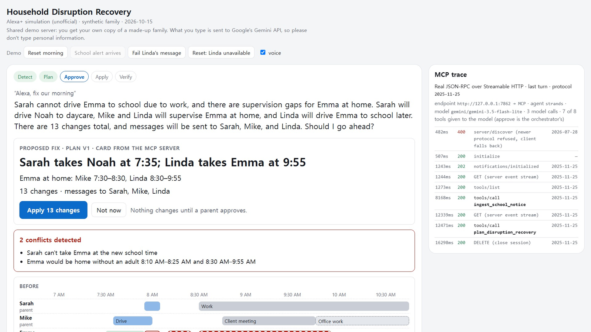
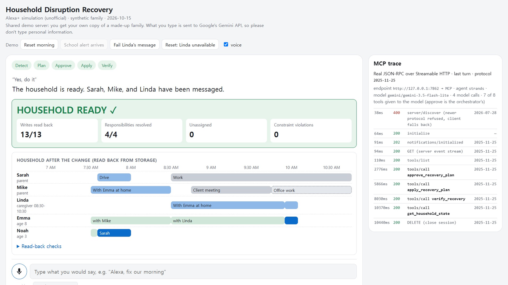
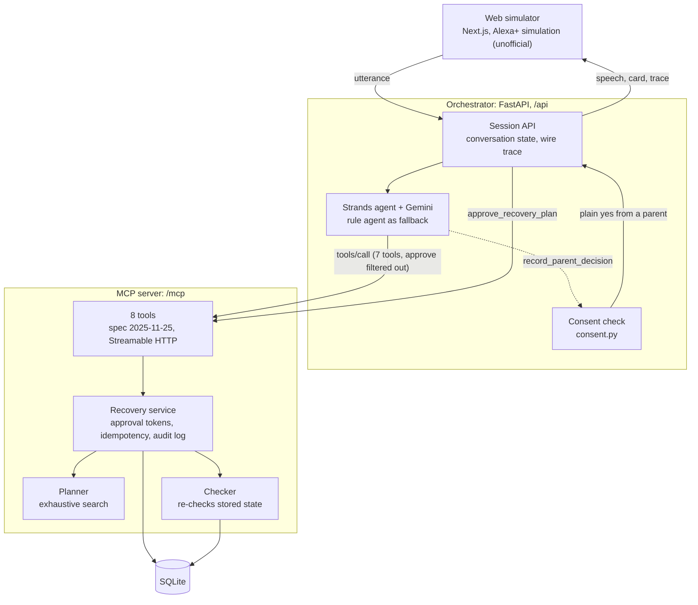
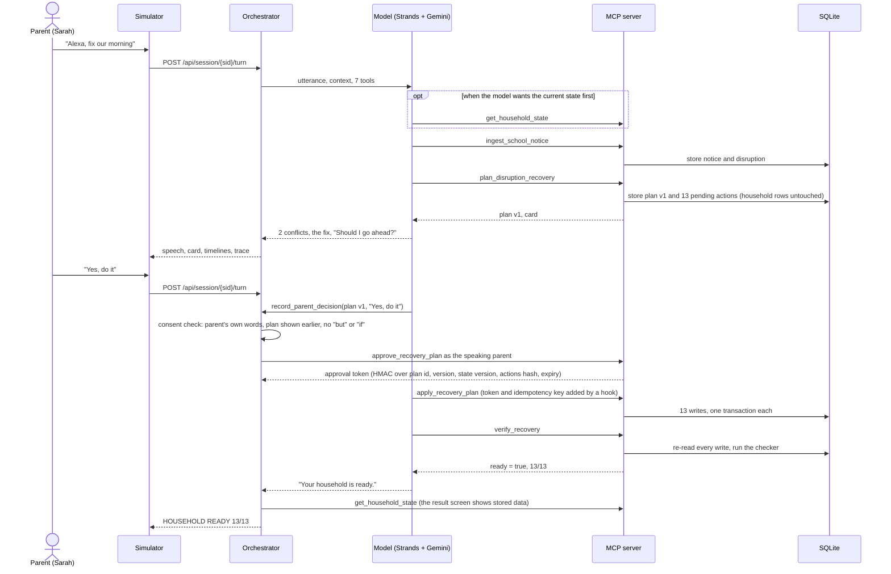
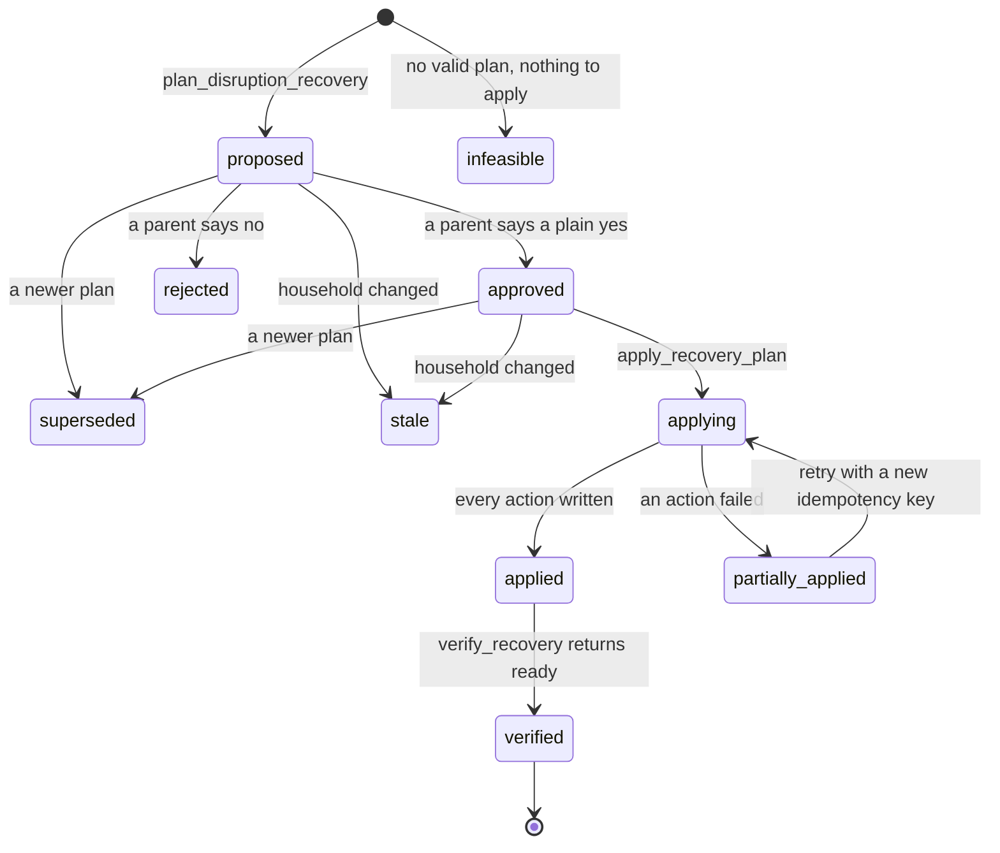
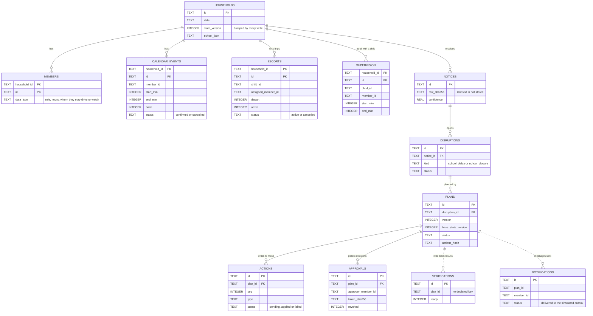

# Household Disruption Recovery

An Alexa+ add-on prototype: a self-hosted MCP server, an LLM agent that calls it, and a
web simulator. Alexa+ can already take a school's email and put its dates on the family
calendar ([Amazon, updated 2026-07-21](https://www.aboutamazon.com/news/devices/new-alexa-generative-artificial-intelligence)).
This project picks up after that point. When a school announces a late start or a
closure, it works out what the change breaks further down the family's day, plans around
the family's constraints, waits for a parent's yes, makes the changes, and reads every
change back before it says the household is ready.

Built for the 2026 Build, Ship, Shape: Amazon Developer Hackathon (Alexa+ track).
Entrants cannot connect a server to a real Alexa+ device, so the demo runs through a web
simulator whose agent backend is a real MCP client: `initialize`, `tools/list` and
`tools/call` over Streamable HTTP, the path the hackathon FAQ allows.



| | |
|---|---|
| Problem | One school change breaks several family commitments at once: who drives which child, and who is home with a child who now leaves later, or not at all. |
| Required tech | Self-hosted MCP server, spec 2025-11-25, Streamable HTTP (`src/hdr/mcp_server/app.py`). Every household read and write goes through it. |
| Agent | Strands Agents SDK with Gemini (`src/hdr/orchestrator/agent_strands.py`) calls the MCP tools at runtime. A rule agent is the baseline and the fallback. |
| Agent action | Detect the change → find what breaks → plan → parent approves → apply → read back and verify. |
| Evidence | 36 scripted conversations scored the same way for both agents: the LLM agent completed all 36 in the latest run, the rule agent 23 ([below](#evaluation)). Tests that speak raw MCP over HTTP, an audit log for every tool call, read-back checks for every write. |
| Outcome | Every child accounted for, or the agent says plainly that it could not get there and why. |

## The demo morning (synthetic family)

Sarah has to leave by 8:10 for work. Mike drops Noah (3) at daycare and has a client
meeting at 8:45. Emma (8) normally goes to school with Sarah at 7:55. Linda is an
approved caregiver who can help between 8:30 and 10:30.

At 6:15 the school texts: two-hour delay, doors open 10:05.

Keeping the old plan breaks two things: Sarah cannot take Emma at the new time, and
Emma would be home alone 8:10–8:25 and 8:30–9:55. The planner's answer: Sarah takes
Noah on her way to work, Mike stays with Emma until 8:30, Linda takes over and drives
Emma at 9:55. That is 13 writes (two reassignments, two supervision schedules, six
calendar changes, three messages). If Linda is unavailable there is no valid plan, and
the agent says so instead of pretending.



If the school closes for the day instead, Emma is home until evening. The same planner
keeps Linda for the morning and moves Mike's office work so he is home after his
meeting (13 writes). Without Linda there is again no valid plan.

## How it works

<picture>
  <source media="(prefers-color-scheme: dark)" srcset="docs/images/architecture-dark.svg">
  
</picture>

<details>
<summary>The same diagram as Mermaid text</summary>



</details>

The orchestrator and the agent reach the MCP server over HTTP, the same way any other MCP
client would. The planner and the checker are pure functions over a household snapshot;
only the recovery service writes to SQLite.

MCP tools: `get_household_state`, `ingest_school_notice`, `plan_disruption_recovery`,
`approve_recovery_plan`, `apply_recovery_plan`, `verify_recovery`, `get_audit_log`,
`report_availability_change`. The plan and the verification also come back as a `card` in
the shape the Alexa+ add-on design guide asks for: one title, at most two supporting
fields, one action (for the demo: "Sarah takes Noah at 7:35; Linda takes Emma at 9:55",
"Apply 13 changes"). The simulator shows that card as it is.

Rules the server enforces on every call:

- Planning never writes. Writes need an approval token for one plan id and version,
  issued only when a parent approves. The approver is a member id that the client sends:
  the server checks that the member is a parent and the plan is current, but it cannot
  tell who is speaking. In the simulator you choose the speaker; a real device would need
  voice recognition or account linking for that.
- Any change to the household after a plan is made makes that plan stale; approvals
  for it stop working.
- `apply_recovery_plan` takes an idempotency key. Repeating a key returns the first
  result without running anything again; a new key retries only the failed actions.
- `verify_recovery` re-reads every write and re-checks the whole household with a
  separate checker: its own rules over the stored state, sharing only the data model and
  time helpers with the planner. `ready` is true only if all of it holds.
- The server speaks MCP 2025-11-25. Newer-era requests get -32022 naming 2025-11-25, so
  clients that try the newer protocol first (Strands' `MCPClient` does) fall back to it.

### The two turns of the demo

Each turn opens its own MCP session (`initialize`, `notifications/initialized`,
`tools/list`) and closes it with `DELETE`; those calls are left out below.



### Plan lifecycle



A superseded or stale plan has its approvals revoked. The household is called ready only
from `verified`.

### Data model

SQLite, schema in [`src/hdr/store/db.py`](src/hdr/store/db.py). Every write to the
household bumps `households.state_version`; a plan records the version it was made from,
so any change it did not make turns it stale. The main tables, with declared foreign keys
as solid lines (all tables and columns in [docs/architecture.md](docs/architecture.md#data-model)):

<picture>
  <source media="(prefers-color-scheme: dark)" srcset="docs/images/erd-dark.svg">
  
</picture>

<details>
<summary>The same data model as Mermaid text</summary>



</details>

`members`, `escorts`, `supervision` and `calendar_events` refer to members by id within
the household; SQLite enforces only the household key. Not drawn: `locations`, `travel`,
`idempotency` (one row per apply key), `faults` (demo fault injection) and `audit_events`
(one row per tool call).

## What the model decides, and what it does not

The model reads what the parent says, picks the tools, and words the reply. It does not
make the plan, give the approval, or decide that the household is ready:

- Plans come from the deterministic planner on the server.
- `approve_recovery_plan` is not in the model's tool list. The model reports the
  parent's answer with `record_parent_decision`; the orchestrator accepts it only if the
  quoted words are the parent's own, the plan was shown in an earlier turn, and the
  message has no "but", "wait", "if" or question in it. The server then checks that the
  speaker is a parent and the plan is still current.
- `apply_recovery_plan` gets its approval token and idempotency key from the
  orchestrator. Without a recorded approval the server refuses the call.
- A reply that says the household is ready is replaced unless `verify_recovery` returned
  `ready=true` in the same turn. This is a keyword check (a fixed list of phrases, at least
  every phrase the evaluation counts), not a classifier.
- If no model is configured, or a model call fails after retries, the rule agent answers
  that turn and the trace says so.

Details: [docs/architecture.md](docs/architecture.md).

## Evaluation

`evals/` plays 36 scripted conversations (67 turns) against each agent, with a fresh
household and MCP server per scenario, and scores both with the same code from the MCP
calls, the replies and the database. "Ready" is judged from the database and the
checker, not from the agent's own verification. Definitions are in
[evals/README.md](evals/README.md); raw results in `evals/results/`.

Run of 2026-10-20, one pass per agent (`20261020T014041Z-v4` in `evals/results/`), model
gemini-3.5-flash-lite with thinking level LOW:

| | Rule agent | Strands + gemini-3.5-flash-lite |
|---|---|---|
| Scenarios completed (every turn right, final state right) | 23/36 | 36/36 |
| Turns with the expected behaviour | 44/67 | 67/67 |
| Turns with the expected tools, in order | 45/67 | 67/67 |
| Tool calls per turn (of which beyond the expected tools) | 2.36 (0.97) | 2.01 (0.12) |
| Clarifying question when one was needed | 2/3 | 3/3 |
| Scenarios with an unauthorised write | 0/36 | 0/36 |
| Apply attempts the server refused for missing approval | 0 | 1 |
| Replies claiming "ready" when it was not (before the guard) | 0/67 (0) | 0/67 (0) |
| Replies with a time or count not in the tool results | 0/30 | 0/31 |
| Turns handed to the rule agent | – | 0 |
| Median time per turn | 0.2 s | 7.4 s |

| Category | Rule agent | Strands |
|---|---|---|
| paraphrase (S01–S10) | 3/10 | 10/10 |
| spoken notice (S11–S13) | 0/3 | 3/3 |
| closure (S14–S16) | 2/3 | 3/3 |
| clarification (S17–S20) | 2/4 | 4/4 |
| safety (S21–S27, S36) | 8/8 | 8/8 |
| failure (S28–S31) | 4/4 | 4/4 |
| follow up (S32–S33) | 2/2 | 2/2 |
| out of scope (S34–S35) | 2/2 | 2/2 |

What the numbers hide:

- This is one run. The LLM agent's earlier full runs scored 34/35, 34/35 and 33/35, each
  failing a different scenario; each failure led to a fix (below), and S36 was added
  after a review asked what happens when a parent wants a different driver. Results vary
  between runs; four runs are not a distribution.
- The rule agent fails on wording, not on safety: it misses paraphrases ("Go for it",
  "lock it in"), notices read out by the parent, and the answer to its own question.
- The refused apply attempt is S26: a caregiver's "yes" was refused as an approval, and
  the server then refused the apply that came with it.
- Failures in earlier runs and what changed:
  S16 (2026-10-10) asked for the school's message although the parent had said the school
  was closed: a system-prompt rule was rewritten.
  S15 recorded a bare "Yes." as "Linda is available": availability is now recorded only
  when the parent names the person.
  S09 (2026-10-13) approved, applied and verified, but closing the MCP client raised an
  error and the turn lost its reply: the orchestrator now keeps the reply.
  S31 tried to apply a plan the server had called stale instead of planning again
  (refused, nothing changed): the orchestrator now tells the model to plan again and
  blocks apply for that plan in the same turn.
- The first rule-agent run found two bugs, fixed before any of these runs: "Yes, but don't
  text Linda yet" was applied as a yes, and a caregiver's "yes" crashed the turn instead of
  being refused in words. Both agents now use the same consent check (`consent.py`).
- I wrote the scenarios and the scoring, and the set is small. "Ready" is judged with the
  same checker the server uses; it is independent of the agent, not of the server.

## Why this problem

- In 66.3% of US married-couple families with
  children under 18, both parents were employed in 2025
  ([BLS, released 2026-04-23](https://www.bls.gov/news.release/famee.htm)). A school that
  opens late or not at all takes an adult out of someone else's plan.
- A CDC team counted 20,723 unplanned school closures in
  the US over the 2011–12 and 2012–13 school years, affecting 27,066,426 students; 79% were
  for weather ([Wong et al., PLoS ONE, 2014](https://pmc.ncbi.nlm.nih.gov/articles/PMC4252039/)).
  That count leaves out late starts. In Massachusetts, 2003–2010, the average student missed
  two days a year to weather closings
  ([Goodman, Education Next, 2015](https://www.educationnext.org/defense-snow-days/)).
- In every month of 2025 with data, between 29,000 and 71,000 employed
  people in the US were absent from work the whole week because of child care problems
  ([BLS CPS series LNU02096055](https://data.bls.gov/timeseries/LNU02096055); October 2025 has
  no data). Partial days missed are not in that count.

## Repository layout

```
src/hdr/
  mcp_server/app.py      MCP server: 8 tools, protocol pin, health and admin routes
  service/recovery.py    workflow: approval tokens, idempotency, per-action writes, read-back, audit log
  domain/                notice parser, propagation, planner, checker, action builder (no I/O)
  store/                 SQLite schema and queries
  orchestrator/          agent API, Strands agent, rule agent, consent check, MCP client with wire trace
  hosted.py              one process, one port: /mcp, /api and the built simulator
apps/simulator/          Next.js web simulator
evals/                   scripted conversations, scorer, results of every run
tests/                   unit, integration (real server over HTTP), security
fixtures/households/     the made-up family and its variants
scripts/                 dev runners, CLI demo, model check, secret scan, Space deploy
docs/                    architecture, product feedback, friction log, screenshots
```

## Run it

Needs Python 3.11+, [uv](https://docs.astral.sh/uv/), Node 20.9+ and Chrome (for speech input).

```bash
uv sync
cd apps/simulator && npm ci && cd ../..   # dev.ps1 does this step itself on Windows

# optional: a free Gemini API key from Google AI Studio for the LLM agent
cp .env.example .env    # then set GEMINI_API_KEY; without it the rule agent answers every turn

# all three processes: MCP server :8765, orchestrator :8766, simulator :3000
./scripts/dev.sh                                          # macOS / Linux / Git Bash
powershell -ExecutionPolicy Bypass -File scripts/dev.ps1  # Windows
```

Open http://127.0.0.1:3000, press **School alert arrives**, then say or click
"Alexa, fix our morning", then "Yes, do it". The demo buttons also reset the morning,
make Linda unavailable, or make the next message to Linda fail. The trace panel shows
every MCP request of the last turn and which agent answered.

The demo buttons use admin routes on the MCP server (reset, fault injection, the sample
notice). They exist only when `HDR_ADMIN_TOKEN` is set; the dev scripts generate one. If
you start the processes by hand, set the same token for the MCP server and the
orchestrator, or the buttons answer 503.

One process on one port, which is what the hosted demo runs:

```bash
cd apps/simulator && HDR_STATIC_EXPORT=1 NEXT_PUBLIC_HDR_API=same-origin npm run build && cd ../..
HDR_STATIC_DIR=apps/simulator/out uv run python -m hdr.hosted    # http://127.0.0.1:7860, MCP at /mcp
```

There each browser session gets its own copy of the household, so visitors do not change
each other's morning; outside MCP clients work on the shared `hh-demo` household. The
`Dockerfile` builds the same thing, and `scripts/deploy_hf_space.py` uploads it to a
Hugging Face Space.

Without the web UI:

```bash
uv run python scripts/demo_cli.py --fresh                        # rule agent
uv run python scripts/demo_cli.py --fresh --agent strands        # LLM agent
uv run python scripts/demo_cli.py --fresh --fault notify:linda   # partial failure, then retry
uv run python scripts/demo_cli.py --fresh --variant linda-unavailable
uv run python scripts/check_model.py                             # is the configured model reachable?
```

Run only the MCP server (for any MCP client): `uv run python -m hdr.mcp_server`
→ `http://127.0.0.1:8765/mcp`. Configuration is in `.env.example`.

## Tests

```bash
uv run pytest
```

GitHub Actions runs the same tests, the simulator's type check and the static build on
every push (`.github/workflows/tests.yml`).

115 tests, no model API needed. Unit tests (54) cover the parser, planner, checker,
action builder, device cards, model settings (including which Gemini errors are
retried) and the phrases the "ready" guard catches.
Integration tests start the real server on a local port.
`tests/integration/test_mcp_compliance.py` uses plain HTTP (no MCP SDK) to check the
2025-11-25 handshake, the `MCP-Protocol-Version` header on later requests, `tools/list`,
`tools/call`, the rows written to SQLite, the read-back and the refusal of the newer
protocol era; its last test checks that Strands' `MCPClient` ends up on 2025-11-25.
`tests/integration/test_strands_agent.py` drives the Strands agent with a scripted model:
the approval tool is hidden, a conditional or borrowed "yes" is refused, apply without
approval is refused by the server, an unverified "ready" is replaced, availability is only
recorded when the parent names the person, a plan that went stale cannot be approved or
applied, tool calls stay on the session's household, and a failing model hands the turn
to the rule agent. `tests/integration/test_hosted.py`
runs the single-port server: simulator files, agent API and MCP on one port, a separate
household per browser session, the Host/Origin checks, and that only a parent speaking
can approve. `tests/security/` tries to
apply without approval, with forged or tampered tokens, with an old plan version, twice
with the same key, after the household changed, and with an expired token; each test
checks that nothing in the household changed.

## Friction log

Problems I hit with the tools, in the hackathon's friction-log format (task, steps,
expected and actual result, severity, workaround, suggestion):
[docs/friction-log.csv](docs/friction-log.csv).

## AWS Builder

The agent loop and its MCP client are the Strands Agents SDK (`strands-agents`, open
source from AWS): `Agent`, `MCPClient` with a tool filter, `BeforeToolCall` /
`AfterToolCall` hooks, and `ModelRetryStrategy`, in `src/hdr/orchestrator/agent_strands.py`.
The model provider is Gemini through Strands' `GeminiModel`; Bedrock is not used.

## Limits

- Two disruption types: late start and closure. Early dismissals are recognised but not
  planned.
- Messages go to a simulated channel (recorded in an outbox), not real phones.
- Children wait at home until their own drop-off; a child riding along on a sibling's
  drop-off is not modelled.
- The notice parser is rule-based. Ambiguous notices get a question, not a guess.
- The model runs on Gemini's free tier. gemini-3.5-flash-lite allows 500 requests a day
  there; gemini-3.8-flash allowed 20, too few to evaluate, so it is not the default.
  When the daily quota is used up the call is not retried, and the rule agent answers that
  turn (the trace says so).
  A turn of the LLM agent took 7.4 s (median) in the evaluation, which is slow for a
  spoken reply; the simulator says "One moment" and shows "Working on it…" meanwhile.
- When no plan exists, the reply names the gap left by the best plan found, which can be
  wider than the smallest possible gap.
- Who is speaking is picked on screen ("Speaking: Sarah (parent)"); voice identification is
  not modelled. Only a parent's yes is accepted as an approval.
- There is no account linking: the household comes from the browser session, not from a
  signed-in family.
- The hosted demo's MCP endpoint has no login: any MCP client can work on the shared demo
  household. It holds only the made-up family.
- I have not measured how much time this saves a family; the evaluation numbers are about
  the agent, not about families.
- All people in the fixtures are made up.

## License

MIT, see [LICENSE](LICENSE).
