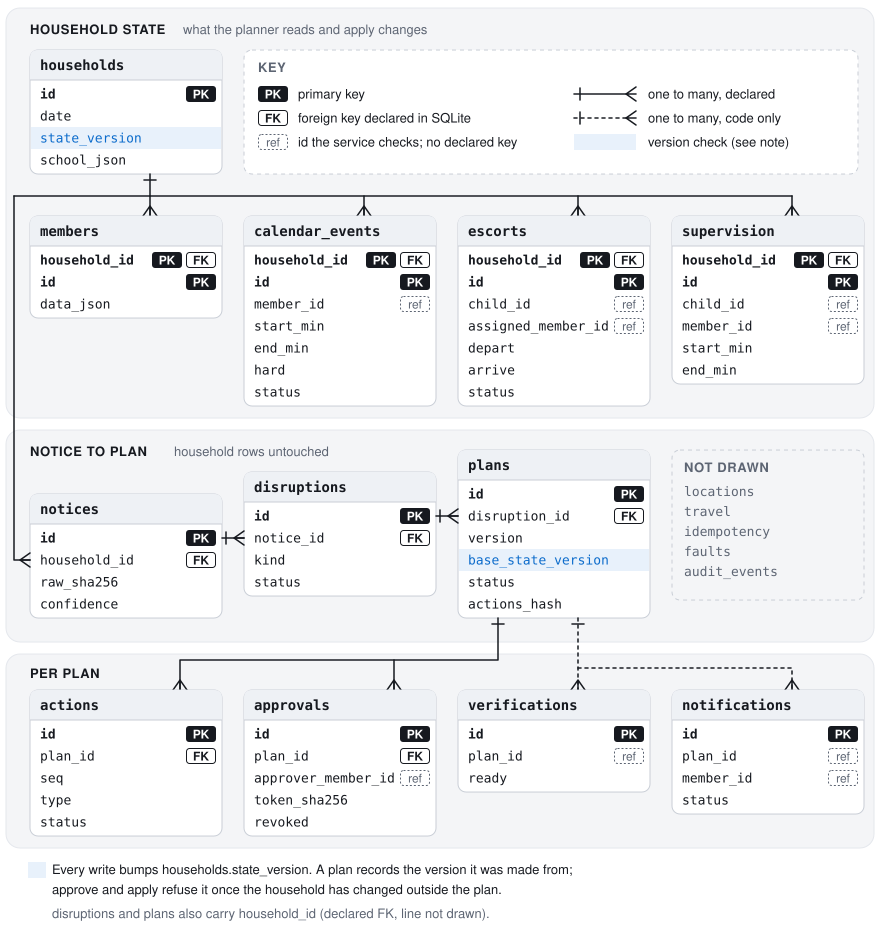
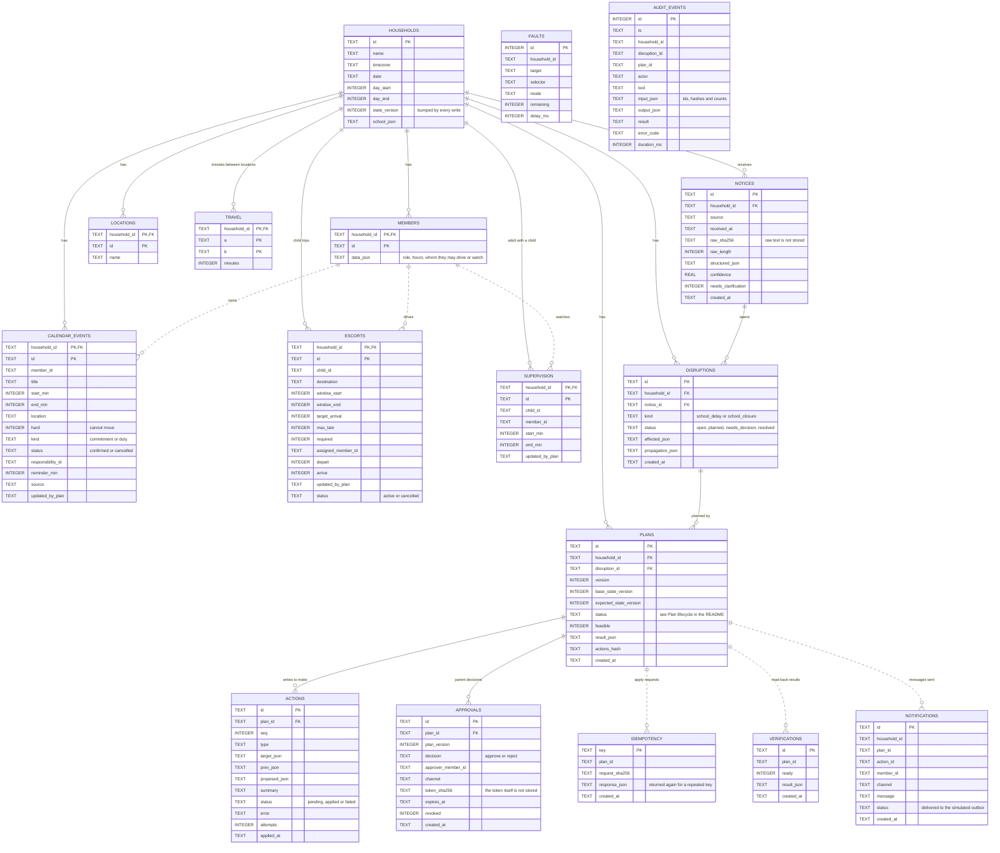

# Architecture

## Components

| Part | Code | Role |
|---|---|---|
| Web simulator | `apps/simulator` | Four screens (normal morning, alert, proposed fix, verified result), speech in/out through the browser, live view of the MCP calls of the last turn. Talks only to the orchestrator. |
| Orchestrator | `src/hdr/orchestrator` | Holds the conversation state, runs the agent, opens one MCP session per turn with the official Python SDK over Streamable HTTP. Records every HTTP exchange for the trace view. |
| LLM agent | `src/hdr/orchestrator/agent_strands.py` | Strands Agents SDK with a pluggable model (Gemini by default, `llm.py`). Connects to the MCP server with Strands' `MCPClient` and decides which tools to call. Guards described below. |
| Rule agent | `src/hdr/orchestrator/agent_rules.py` | Regex intents and fixed tool sequences. Baseline for the evaluation and fallback when the model is missing or fails. Everything it says is built from tool results. |
| Consent check | `src/hdr/orchestrator/consent.py` | Decides whether a parent's words count as a plain yes. Shared by both agents. |
| MCP server | `src/hdr/mcp_server/app.py` | Eight tools with structured outputs and tool annotations; plan and verify results include a device `card` (title, up to two fields, one action), `/healthz`, demo-only admin routes behind a token. DNS-rebinding protection on, binds to localhost by default. |
| Recovery service | `src/hdr/service/recovery.py` | Workflow, approval tokens, idempotency, per-action execution, read-back verification, audit log. |
| Domain | `src/hdr/domain` | Notice parser, propagation, planner, checker, action builder. Pure functions over a household snapshot. |
| Storage | `src/hdr/store` | SQLite. Every write bumps the household `state_version`. |
| Single-port server | `src/hdr/hosted.py` | For the hosted demo: MCP server at `/mcp`, orchestrator at `/api`, the built simulator at `/`, one process. The agent still reaches the MCP server over HTTP on that port. One household per browser session. `Dockerfile` builds it. |

## A turn, end to end

1. Simulator posts the utterance to the orchestrator.
2. Orchestrator opens an MCP session: `initialize` (2025-11-25) → `notifications/initialized`
   → `tools/list`. Later requests carry `MCP-Protocol-Version: 2025-11-25` and the session id.
3. Agent calls tools. For "fix our morning": `get_household_state`, `ingest_school_notice`,
   `plan_disruption_recovery`. For "yes": `approve_recovery_plan`, `apply_recovery_plan`,
   `verify_recovery`.
4. Session is closed (`DELETE`). The orchestrator returns the speech, the screen to show,
   and the wire trace.

## LLM agent and its guards

The model reads the parent's words and the orchestrator's context block (speaker, open
disruption, latest plan and whether it was shown, any unprocessed school notice) and calls
MCP tools through Strands. It never holds the authority to change the household:

- `approve_recovery_plan` is filtered out of the model's tool list. The model reports the
  parent's answer with a local tool, `record_parent_decision(plan_id, decision, parent_words)`.
  The orchestrator accepts it only if the quoted words are in this turn's utterance, the plan
  was shown in an earlier turn, and the utterance has no hedge or condition ("but", "wait",
  "if", a question...). Then the orchestrator calls `approve_recovery_plan` as the speaking
  member; the server still checks that the member is a parent and the plan is current.
- A Strands `BeforeToolCall` hook overwrites `approval_token` and `idempotency_key` on every
  `apply_recovery_plan` call. Without a recorded approval the token is empty and the server
  refuses.
- If the reply says the household is ready and `verify_recovery` did not return
  `ready=true` in the same turn, the orchestrator replaces the reply.
- If the household changed after the plan was shown (someone's availability, say), the
  server refuses the approval as STALE_PLAN; the orchestrator then blocks `apply_recovery_plan`
  for that plan for the rest of the turn and tells the model to plan again.
- After a turn in which the model called a write tool, the orchestrator reads the household
  back with `get_household_state`, so the result screen shows what is stored, not what the
  model last fetched.
- Every tool call that names a household is pinned to the session's household before it
  is sent, so the model cannot read or change another one (relevant on the shared hosted
  server, where each browser session has its own household).
- If no model is configured, or the model call fails after retries, the rule agent handles
  that turn and the trace says so. Overload (503) and per-minute limits are retried with
  backoff; a per-day quota error is not, since it cannot succeed before the daily reset.

The Strands `MCPClient` (on MCP SDK 2.x) first probes the 2026-07-28 protocol with
`server/discover`. The server answers that with -32022 and lists 2025-11-25 as supported,
so the client falls back to `initialize` and every later request carries
`MCP-Protocol-Version: 2025-11-25` (`PinHandshakeProtocol` in `mcp_server/app.py`).

## Planner

Search space: who drives each child and when (5-minute grid inside the arrival window),
which soft calendar entries could be moved, and whether an on-call caregiver is called in.
Each combination is scored lexicographically:

1. required trips without a driver
2. hard violations: schedule conflicts including travel time, availability windows,
   any minute a child who needs supervision is home without an approved adult
3. changed commitments (reassignments, retimes, moved soft events, caregivers called in)
4. minutes late
5. people whose day changes (each gets a message)
6. distance from the preferred arrival time

The search is exhaustive (120 combinations for the demo, capped at 100,000), so every
choice can be explained by comparing it with the best plan that made a different choice:
"Mike could drive Emma after his meeting, but that changes 4 commitments instead of 3."

A school closure removes the trip to school instead of moving it. A child with no trip that
day needs an adult until the end of the modelled day, and the same search, objective and
checker handle it.

Supervision is derived, not searched: given everyone's trips and commitments, each adult's
time at home is known, and a greedy pass assigns who is with each child (the adult who will
drive the child takes the last stretch, otherwise whoever can stay longest).

## Approval and execution

- `plan_disruption_recovery` stores the plan, its actions and a hash of the actions.
  A new plan for the same disruption supersedes the old one and revokes its approvals.
- `approve_recovery_plan` accepts only a parent, only the current version, only if the
  household has not changed since planning. It returns an HMAC token over
  plan id, version, base state version, action hash and expiry; the server keeps a hash.
- `apply_recovery_plan` checks the token, the stored approval, the plan status and the
  state version, then claims the idempotency key and runs pending or failed actions in
  order. Each action is its own transaction and bumps the state version; the plan records
  the version it expects next, so outside changes make it stale.
- Fault injection (`/admin/faults`, tests, demo button) is checked before each action and
  is not reachable through MCP.

## Verification

`verify_recovery` opens a fresh connection and:

- reads each action's target back and compares it with the expected value
  (escort owner and times, supervision segments, calendar rows, delivered messages);
- loads the whole household and runs `domain/checker.py`, which works on the explicit
  stored state (it does not recompute a plan): owners and permissions, arrival windows,
  travel times between consecutive commitments, availability, supervision coverage.

`ready` is true only when the plan was feasible, every write matches, and the checker finds
nothing. If a write failed, the result lists it and the household is not marked ready.

## Data model

All tables, from [`src/hdr/store/db.py`](../src/hdr/store/db.py). Times of day are
minutes after midnight in the household's time zone. Solid lines are foreign keys declared in
SQLite (`PRAGMA foreign_keys=ON`). Dotted lines are references the service keeps without a
declared key: member ids, and the plan id on the bookkeeping tables.

The main tables and their key columns, grouped:

<picture>
  <source media="(prefers-color-scheme: dark)" srcset="images/erd-dark.svg">
  
</picture>

Every table and column:

`faults` holds the demo's injected failures (not reachable over MCP). `audit_events` has
one row per tool call, indexed by disruption.

## Data and privacy

Fixtures are synthetic. The audit log stores ids, hashes and counts; the raw notice text
is stored only as a SHA-256 and length. Approval tokens are stored as hashes.

On the hosted server the MCP endpoint is public and has no login: it only holds the made-up
family, the Host and Origin headers are checked against the server's own host name, and the
admin routes need a token that is generated at start. What visitors type goes to Gemini's
API; the simulator page says so.
